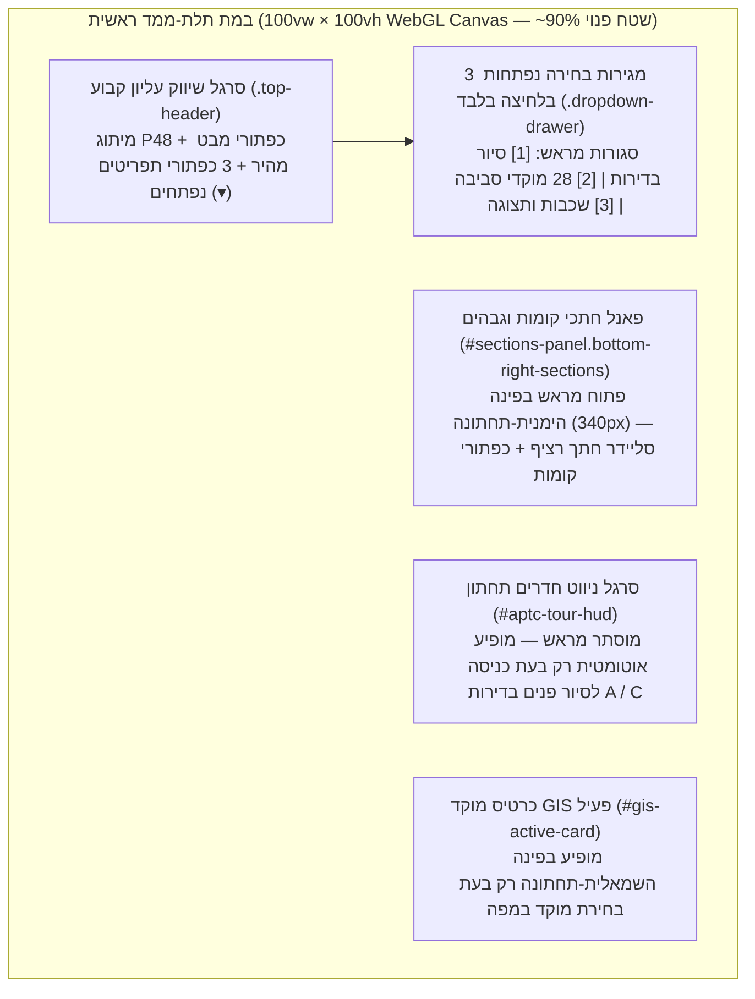

# מסמך עיצוב, חוויית משתמש ושפה חזותית (UI/UX & 3D Design System)
## מערכת שיווק תלת-ממדית — פרויקט פינס 48 פינת הבעל שם טוב, פתח תקווה

> [!NOTE]
> **עקרון העיצוב המרכזי (Clean Marketing Stage)**: המערכת תוכננה למצגות מכירה ושיווק נדל"ן שבהן המודל התלת-ממדי ומפת הסביבה תופסים כ-**90% משטח המסך** ללא הסתרה. כל תפריטי הבחירה והגלילה סגורים מראש ונפתחים רק בדרישה בלחיצה (`On-Demand Popover Drawers`), בעוד **תפריט המשחק עם החתכים** הוא הפאנל היחיד הפתוח כברירת מחדל בפינה הימנית-תחתונה.

---

## 1. ארכיטקטורת המסך ופריסת הרכיבים (Viewport Layout)

### 1.1 טבלת מצבי ברירת מחדל והתנהגות רכיבי ה-UI
| רכיב ממשק | מזהה DOM / CSS | מיקום במסך | מצב פתיחה התחלתי | התנהגות אינטראקטיבית |
| :--- | :--- | :--- | :--- | :--- |
| **סרגל כותרת עליון** | `header.top-header` | למעלה (`top: 12px; left: 14px; right: 14px`) | **גלוי תמיד** (שורה אחת קומפקטית) | כולל מיתוג הפרויקט, מתגי רדיוסים/מיקומים מהירים, ו-3 כפתורי פתיחת תפריטים |
| **פאנל חתכי קומות (Dollhouse)** | `#sections-panel.bottom-right-sections` | **פינה ימנית-תחתונה** (`bottom: 14px; right: 14px; width: 340px`) | **פתוח מראש** (הפאנל היחיד שפתוח) | מאפשר משחק מיידי בסליידר החתך (`0.50m..29.50m`) או קפיצה לחתך קומה 3 המרוהטת; ניתן למזעור בלחיצה על `— מזער` |
| **מגירת סיור בדירות (A / C)** | `#drawer-apartments.dropdown-drawer` | נפתחת מתחת לסרגל העליון (`top: 68px; right: 14px`) | **סגור מראש** (`display: none`) | נפתח בלחיצה על `✨ סיור בדירות (A / C) ▾`; נסגר אוטומטית בבחירת דירה, בלחיצה על `✕`, בלחיצה על המודל או ב-`Esc` |
| **מגירת מוקדי סביבה (28 POIs)** | `#drawer-gis.dropdown-drawer` | נפתחת מתחת לסרגל העליון (`top: 68px; right: 14px`) | **סגור מראש** (`display: none`) | נפתח בלחיצה על `📍 מוקדי סביבה וסינון (28) ▾`; כולל סינון לפי 5 קטגוריות ורשימת גלילה מהירה |
| **מגירת שכבות ותצוגה** | `#drawer-settings.dropdown-drawer` | נפתחת מתחת לסרגל העליון (`top: 68px; right: 14px`) | **סגור מראש** (`display: none`) | נפתח בלחיצה על `⚙️ שכבות ותצוגה ▾`; כולל שכבות קומות, הדגשת חומרים, זווית שמש וייצוא `.OBJ` |
| **סרגל ניווט חדרים (Walk HUD)** | `#aptc-tour-hud.aptc-hud` | למטה משמאל לפאנל החתכים (`bottom: 14px; left: 14px; right: 368px`) | **סגור מראש** (`display: none`) | נפתח אוטומטית רק בעת סיור פנים בדירות A / C, ונסגר מיד במעבר למבט חוץ/מפה או בלחיצה על `✕ סגור סרגל` |

---

## 2. מערכת צבעים, טיפוגרפיה וטוקנים עיצוביים (UI Design Tokens)

### 2.1 פלטת צבעי הממשק (Glassmorphism Marketing UI)
- **רקע פאנלים שקוף-למחצה (`Glass Panel`)**: `rgba(255, 255, 255, 0.94)` עם `backdrop-filter: blur(14px)` וגבול עדין `1px solid rgba(203, 213, 225, 0.85)`.
- **צבע מותג ראשי (Royal Architectural Blue)**: `#1e3a8a` / `#2563eb` — משמש לכפתורי מבט פעילים, כותרות GIS וטבעת המיקוד של הפאנל הימני-תחתון.
- **צבע יוקרה לדירות לדוגמה (Warm Luxury Amber/Gold)**: `linear-gradient(135deg, #b45309 0%, #d97706 100%)` עם הילה `#fde68a` — מבליט את כפתורי הכניסה לדירות המרוהטות A ו-C ואת כפתור חתך קומה 3.
- **קידוד צבעוני לקטגוריות ה-GIS (28 מוקדים)**:
  - 🎓 **חינוך ובתי ספר (9)**: כחול רויאל `#2563eb`
  - 🚌 **תחבורה ציבורית, רכבת קלה ומטרו (7)**: כתום-זהב `#d97706`
  - 🛒 **מסחר וקניונים (6)**: סגול `#9333ea`
  - 🌳 **פארקים, ספורט וקהילה (3)**: ירוק אזמרגד `#059669`
  - 🏥 **בריאות ומרפאות (3)**: אדום `#dc2626`

### 2.2 טיפוגרפיה וכיווניות (RTL Hebrew-First Typography)
- **כיווניות**: `dir="rtl"`, `lang="he"` מלא בכל הרכיבים, המגירות והתוויות התלת-ממדיות.
- **פונט מערכת**: `system-ui, -apple-system, BlinkMacSystemFont, "Segoe UI", Roboto, sans-serif`.
- **מספרים ומפלסי גובה (`.cad-badge`)**: `font-variant-numeric: tabular-nums` להצגה אחידה ומדויקת של גבהים אבסולוטיים ויחסיים (`+10.37`, `+19.72`, `+28.67`).

---

## 3. מפרט חומרים וטקסטורות תלת-ממד (3D PBR Material Palette)

המודל התלת-ממדי משלב את מקרא החומרים הרשמי מגיליונות החזיתות של **נחומי אדריכלים** (`A-1007`) יחד עם חומרי פנים יוקרתיים בעלי קונטרסט גבוה וברור בין הקירות לריצוף:

| מזהה חומר (`matKey`) | שם החומר האדריכלי | גוון / טקסטורה | תכונות PBR (`roughness` / `metalness`) | יישום במודל |
| :--- | :--- | :--- | :--- | :--- |
| `mat_D_white_plaster` | **D — טיח חוץ לבן אדריכלי** | `#fbfaf8` | `R: 0.72, M: 0.02` | קירות החוץ המרכזיים והקורה הדקורטיבית המעוגלת בפינה הצפון-מזרחית |
| `mat_B_gray_plaster` | **B — טיח חוץ אפור כהה** | `#5f6368` | `R: 0.70, M: 0.05` | מסגרות ה-L האנכיות של המרפסות, קירות ההדגשה בצפון ובמזרח ומעקות גג דופלקס |
| `mat_C_white_louvers` | **C — מסתורי כביסה מאלומיניום** | `#e8edf2` | `R: 0.36, M: 0.35` | 3 פירי רפפות מסתור כביסה (מערב, צפון-מזרח ודרום) |
| `mat_A_iron_railing` | **A — מעקות ברזל וזכוכית** | `#24282e` | `R: 0.35, M: 0.80` | מעקות מרפסות השמש ומרפסות הגג |
| `mat_interior_wall` | **קירות פנים מוחלקים** | `#fdfcfb` (לבן נקי) | `R: 0.64, M: 0.01` | כלל קירות הפנים והמחיצות — יוצר קונטרסט חד וברור מול הריצוף האפור הבהיר |
| `mat_terrace_tile` / `mat_lux_travertine` | **ריצוף פורצלן אפור בהיר (`120×120`)** | `#b4bac2` + פוגות `#747b85` | `R: 0.32, M: 0.05` | ריצוף קומות המגורים, הסלון, המטבח והמרפסות (קונטרסט גבוה מול קירות הפנים הלבנים) |
| `mat_lux_parquet` | **פרקט אלון טבעי חם** | `#d8bc96` (דוגמת פישבון/פלאנק) | `R: 0.42, M: 0.04` | ריצוף חדרי השינה וסוויטות ההורים בדירות A ו-C |
| `mat_lux_calacatta` | **שיש קלקטה לבן-זהב** | `#fcfaf7` + עורקים זהובים/אפורים | `R: 0.18, M: 0.08` | אי המטבח (`Waterfall Island`), משטחי העבודה, שולחן האוכל וחיפויי חדרי הרחצה |
| `mat_lux_light_wood` | **פורניר אלון טבעי וקשמיר** | `#d6b284` / `#e8dfd1` | `R: 0.44, M: 0.05` | נגרות המטבח, קיר הטלוויזיה המחורץ (`Fluted Oak`) וארונות הקיר בחדרי השינה |

---

## 4. זוויות מצלמה מוגדרות מראש (Camera & Cut Presets)

| מזהה מצב (`VIEW_PRESETS`) | כפתור בממשק | זוויות (`theta`, `phi`, `radius`) | גובה חתך (`clip`) | תיאור התצוגה |
| :--- | :--- | :--- | :--- | :--- |
| `gmaps_regional` | **🗺️ מפת סביבה / כל המיקומים (2 ק"מ)** | `θ=2.38, φ=0.56, r=1550m` | `29.50m` (מלא) | מבט אווירי רחב המציג את הבניין, כל 8 רדיוסי המרחק וכל 28 מוקדי הסביבה והמטרו |
| `gmaps_aerial` | **🗺️ רדיוס שכונתי (1 ק"מ)** | `θ=2.38, φ=0.62, r=680m` | `29.50m` (מלא) | התמקדות בטבעות 150–1,000 מ' ובמוסדות החינוך, המסחר והתחבורה השכונתיים |
| `gmaps_close` | **🏢 תקריב הצומת (300 מ')** | `θ=2.38, φ=0.68, r=220m` | `29.50m` (מלא) | תקריב חד (`Zoom 19`, `0.25m/px`) על פינת הרחובות פינס והבעל שם טוב |
| `iso_ne` | **🏢 מבט הבניין / מבנה שלם** | `θ=2.48, φ=1.18, r=56m` | `29.50m` (מלא) | מבט חוץ אדריכלי מרכזי מהפינה הצפון-מזרחית המעוגלת של הצומת |
| `enterFloor3BothDollhouseMode` | **✨ חתך קומה 3 המרוהטת (A + C)** | `θ=1.85, φ=0.58, r=24.5m` | `12.68m` | חתך אופקי של קומה 3 המציג מלמעלה את דירות היוקרה המרוהטות A ו-C יחד |
| `cut_ground` | **🚪 קומת קרקע ולובי** | `θ=2.65, φ=0.62, r=38m` | `2.30m` | חתך קומת הקרקע, הלובי הראשי, החניון והמגרש |
| `cut_f1_5` | **📐 קומות 1–5 (A,B,C)** | `θ=2.75, φ=0.58, r=38m` | `5.95m` | חתך קומה טיפוסית המציג את חלוקת הפנים של דירות A, B ו-C |
| `cut_f6` | **🏡 קומה 6 (דופלקסים)** | `θ=2.70, φ=0.58, r=38m` | `21.45m` | חתך מפלס תחתון של הדופלקסים `PB` ו-`PC` ומרפסות הגג |
| `cut_f7` | **☀️ קומה 7 (גג עליון)** | `θ=2.70, φ=0.58, r=36m` | `24.35m` | חתך מפלס עליון של הדופלקסים והפרגולות האדריכליות |
| `top_plan_f1_5` | **📏 תוכנית 1:50 מלמעלה** | `θ=0.00, φ=0.02, r=42m` (אורתוגרפי) | `5.95m` | היטל אורתוגרפי דו-ממדי מדויק בקנ"מ `1:50` של הקומה החתוכה |
