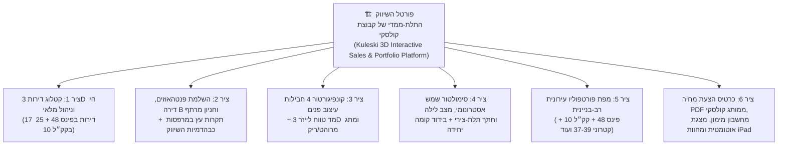

# תוכנית אסטרטגית ואפיון שדרוגים: הפיכת המערכת לפלטפורמת השיווק והמכירות הרב-בניינית של "קבוצת קולסקי" (Next-Gen 3D PropTech Sales Platform)

> [!IMPORTANT]
> **תגלית מרכזית מתוך מאגר הפרויקטים ב-Google Drive**:
> בסריקת עומק של תיקיות הפרויקטים ב-`G:\תיקיות אחסון שיתופי\פרויקטים שוטפים\פרויקטים בביצוע\` ושל סביבת הפיתוח המקומית, איתרנו וחילצנו את **נתוני האמת הרשמיים** של הדירות, השטחים, הכיוונים, התמחור, המפרט הטכני והדמיות האדריכל עבור **פינס 48**, **קק"ל 10** ופרויקטים נוספים של **"יצחק קולסקי חברה לבניה והשקעות בע"מ" (קבוצת קולסקי)**. כל הנתונים האלו מוכנים להטמעה ישירה במערכת השיווק התלת-ממדית!

---

## 1. נתוני האמת שנחשפו ומוכנים להטמעה מיידית במערכת (Verified Real-World Inventory Data)

### 1.1 פרויקט פינס 48 פינת הבעש"ט — טבלת 17 הדירות הרשמית
מתוך [`פרוטוקול חלוקה -פינס 48 - 7 ביולי 2025.xlsx`](file:///G:/תיקיות אחסון שיתופי/פרויקטים שוטפים/פרויקטים בביצוע/פינס הבעשט/הסכמים מול בעלי הקרקע/פרוטוקול חלוקה/פרוטוקול חלוקה -פינס 48 - 7 ביולי 2025.xlsx), [`קובץ הקמת יחידות דיור בשופר.xlsx`](file:///G:/תיקיות אחסון שיתופי/פרויקטים שוטפים/פרויקטים בביצוע/פינס הבעשט/ניהול פרויקט/עותק של חדש! קובץ הקמת יחידות דיור בשופר.xlsx) ו-[`דוח אפס.pdf`](file:///G:/תיקיות אחסון שיתופי/פרויקטים שוטפים/פרויקטים בביצוע/פינס הבעשט/כספים וחשבונות/דוח  אפס.pdf):

| מס' דירה | קומה | טיפוס במודל | כיווני אוויר | חדרים | שטח דירה (מ"ר) | מרפסת שמש / גג (מ"ר) | חניות | שווי כולל מע"מ (₪) | שיוך וזמינות שיווקית |
| :---: | :---: | :---: | :--- | :---: | :---: | :---: | :---: | :---: | :--- |
| **1** | קומה 1 | `A1` | צפון – מזרח | 4 | 92 מ"ר | 12 מ"ר | 1 | ₪2,550,000 | 🔒 דירת בעלים (אהד) |
| **2** | קומה 1 | `B1` | צפון – מערב | 3 | 80 מ"ר | 12 מ"ר | 1 | ₪2,280,000 | 🔒 דירת בעלים (אהד) |
| **3** | קומה 1 | `C1` | דרום – מזרח | 4 | 94 מ"ר | 12 מ"ר | 1 | **₪2,600,000** | 🟢 **מלאי קולסקי — פנויה למכירה** |
| **4** | קומה 2 | `A2` | צפון – מזרח | 4 | 92 מ"ר | 12 מ"ר | 1 | **₪2,560,000** | 🟢 **מלאי קולסקי — פנויה למכירה** |
| **5** | קומה 2 | `B2` | צפון – מערב | 3 | 80 מ"ר | 12 מ"ר | 1 | ₪2,300,000 | 🔒 דירת בעלים (גולדמן) |
| **6** | קומה 2 | `C2` | דרום – מזרח | 4 | 94 מ"ר | 12 מ"ר | 1 | **₪2,620,000** | 🟢 **מלאי קולסקי — פנויה למכירה** |
| **7** | קומה 3 | `A3` *(מרוהטת 3D)* | צפון – מזרח | 4 | 92 מ"ר | 12 מ"ר | 1 | **₪2,580,000** | 🟢 **מלאי קולסקי — פנויה למכירה** |
| **8** | קומה 3 | `B3` | צפון – מערב | 3 | 80 מ"ר | 12 מ"ר | 1 | ₪2,310,000 | 🔒 דירת בעלים (אהד) |
| **9** | קומה 3 | `C3` *(מרוהטת 3D)* | דרום – מזרח | 4 | 94 מ"ר | 12 מ"ר | 1 | **₪2,630,000** | 🟢 **מלאי קולסקי — פנויה למכירה** |
| **10** | קומה 4 | `A4` | צפון – מזרח | 4 | 92 מ"ר | 12 מ"ר | 1 | **₪2,590,000** | 🟢 **מלאי קולסקי — פנויה למכירה** |
| **11** | קומה 4 | `B4` | צפון – מערב | 3 | 80 מ"ר | 12 מ"ר | 1 | **₪2,330,000** | 🟡 **משותפת (קולסקי 48.5% / גולדמן)** |
| **12** | קומה 4 | `C4` | דרום – מזרח | 4 | 94 מ"ר | 12 מ"ר | 1 | **₪2,650,000** | 🟢 **מלאי קולסקי — פנויה למכירה** |
| **13** | קומה 5 | `A5` | צפון – מזרח | 4 | 92 מ"ר | 12 מ"ר | 1 | **₪2,610,000** | 🟢 **מלאי קולסקי — פנויה למכירה** |
| **14** | קומה 5 | `B5` | צפון – מערב | 3 | 80 מ"ר | 12 מ"ר | 1 | ₪2,340,000 | 🔒 דירת בעלים (אהד) |
| **15** | קומה 5 | `C5` | דרום – מזרח | 4 | 94 מ"ר | 12 מ"ר | 1 | **₪2,660,000** | 🟢 **מלאי קולסקי — פנויה למכירה** |
| **16** | קומות 6+7 | `PB` (דופלקס פנטהאוז) | מערב / צפון / דרום | 5 | 136 מ"ר | **137 מ"ר גג** | 1 | **₪4,070,000** | 🟢 **קולסקי (78.2%) — פנטהאוז למכירה** |
| **17** | קומות 6+7 | `PC` (דופלקס פנטהאוז) | מזרח / צפון / דרום | 5 | 131 מ"ר | **113 מ"ר גג** | 1 | **₪3,790,000** | 🟡 **משותפת (קולסקי 10% / יוספה+ילוביצקי)** |

### 1.2 בניינים נוספים של קבוצת קולסקי שזמינים לאיחוד לפלטפורמה רב-בניינית
1. **פרויקט קק"ל 10, פתח תקווה** ([`kkl10`](file:///C:/Users/guyku/.gemini/antigravity/scratch/kkl10) + [`פרויקט קקל 10 -מלאי דירות לשדרוג.pdf`](file:///G:/תיקיות אחסון שיתופי/פרויקטים שוטפים/פרויקטים בביצוע/קקל 10/פרויקט קקל 10 -מלאי דירות לשדרוג.pdf)):
   - כולל **מודל תלת-ממדי BIM v6.1 מוכן** (`3,635` גופים סגורים + `32,617` קווי CAD) וטבלת תמחור רשמית של **25 יחידות דיור** בקומות 0–8 (דירות גן 108 מ"ר + 110 מ"ר גינה, דירות 4–5 חדרים ופנטהאוזים בקומה 8 עד 159 מ"ר + 44 מ"ר מרפסת), מתוכן **16 דירות מלאי יזם (קולסקי)**!
2. **פרויקט 410-0560680** ([`Realistic_360_Viewer.html`](file:///C:/Users/guyku/.gemini/antigravity/scratch/Realistic_360_Viewer.html)): מודל תלת-ממדי של צמד בניינים מוכן ב-Three.js.
3. **10 פרויקטים נוספים בתיקיית `פרויקטים בביצוע` בפתח תקווה**:
   - **קטרוני 37–39** (כולל תיקיית `מודל` מלאה עם תוכניות כל הקומות והחזיתות!), **סלומון 11–13**, **פאירברג 3**, **חפץ מרדכי 7**, **אברבנאל 15**, **אברהם גפני 2**, **היבנר 11**, **חפץ חיים 44**, **יטקובסקי 7** ו**משה שרת**.

---

## 2. ששת צירי השדרוג להפיכת המערכת ל-"Kuleski 3D Sales Platform"

### ציר 1: מערכת בחירת דירות תלת-ממדית חיה וניהול מלאי (3D Interactive Unit Selector & Live CRM)
1. **בחירת דירות בלחיצה ישירות על חזית הבניין התלת-ממדי (3D Clickable Unit Volumes)**:
   - מעבר עכבר (`Hover`) או לחיצה (`Click`) על כל אחת מ-17 הדירות בפינס 48 מדגיש את הדירה בהילה תלת-ממדית לפי זמינות אמת:
     - 🟢 **ירוק אזמרגד (`מלאי קולסקי — פנויה למכירה`)**: דירות `3, 4, 6, 7, 9, 10, 12, 13, 15, 16`.
     - 🟡 **זהב/ענבר (`דירה משותפת / בשריון`)**: דירות `11, 17`.
     - ⚪ **אפור אלגנטי (`דירת בעלים / נמכרה`)**: דירות `1, 2, 5, 8, 14` (עם מתג סינון מהיר: **"הצג רק דירות פנויות של קולסקי"**).
2. **סינון חכם לרוכשים בזמן אמת (Smart Buyer Filter)**:
   - סינון לפי **מספר חדרים** (`3 חד'`, `4 חד'`, `דופלקס פנטהאוז 5 חד'`), **קומה**, **כיווני אוויר** ו**טווח תקציב** — הדירות המתאימות זוהרות על המודל והשאר הופכות לשקופות (`Ghost`).
3. **כרטיס דירה שיווקי + מצב עריכת מנהל מכירות (Sales Manager Mode)**:
   - הצגת שטח דירה, שטח מרפסת, כיוונים, חניה משויכת, מפרט טכני רשמי מתוך [`פינס פינת הבעשט.pdf`](file:///G:/תיקיות אחסון שיתופי/פרויקטים שוטפים/פרויקטים בביצוע/פינס הבעשט/שיווק והדמיות/פינס פינת הבעשט.pdf), וכפתור מעבר מיידי לסיור פנים או לחתך הקומה של אותה דירה.
   - אפשרות לעדכן סטטוס (`פנוי` / `שמור` / `נמכר`) ומחיר בזמן אמת או להסתיר מחירים בתצוגת לקוח.

---

### ציר 2: השלמת הפערים האדריכליים והוויזואליים במודל פינס 48 (Architectural & Interior Fidelity Boost)
1. **התאמה 1:1 להדמיות השיווק הרשמיות של נחומי אדריכלים ([`6315_09.jpg`](file:///G:/תיקיות אחסון שיתופי/פרויקטים שוטפים/פרויקטים בביצוע/פינס הבעשט/שיווק והדמיות/6315_09.jpg) ו-[`6315_10.jpg`](file:///G:/תיקיות אחסון שיתופי/פרויקטים שוטפים/פרויקטים בביצוע/פינס הבעשט/שיווק והדמיות/6315_10.jpg))**:
   - **חיפוי עץ חם בתקרות המרפסות והפרגולות (Warm Wood Soffits)**: הוספת שכבת עץ אלון בתחתית תקרות כל מרפסות השמש ובתקרות פרגולות הדופלקסים.
   - **אדניות וצמחייה נשפכת במרפסות + תאורת ספוטים שקועה** במרפסות ובלובי.
   - **ריהוט לובי הכניסה הראשי בקומת הקרקע (`0.00`)**: דלפק קבלה משיש ועץ מחורץ, פינת המתנה, תאורת אווירה ומראות דקורטיביות.
2. **מידול קומת מרתף החניון של פינס 48 (`A-1000` מתוך [`215-work-plans-pm-1.pdf`](file:///G:/תיקיות אחסון שיתופי/פרויקטים שוטפים/פרויקטים בביצוע/פינס הבעשט/תכנון וביצוע/אדריכלות ותכניות לביצוע/215-work-plans-pm-1.pdf))**:
   - הוספת שכבת מרתף החניון במפלס `-3.50m (+36.10m)` עם **18 תאי החניה הממוספרים**, רמפת הכניסה ולובי המעלית התת-קרקעי, כולל כפתור **`🚗 הצג את החניה שלי במרתף`** מתוך כרטיס הדירה!
3. **ריהוט 3D מלא לדירה B (3 חדרים) ולדופלקסי הפנטהאוז PB ו-PC (קומות 6–7)**:
   - **דירה B (80 מ"ר + 12 מ"ר מרפסת)**: ריהוט מלא של הסלון, המטבח, המרפסת הצפון-מערבית וחדרי השינה בקומה 3 (כך שכל 3 הדירות בקומה 3 — `A`, `B`, `C` — תהיינה מרוהטות במלואן!).
   - **פנטהאוזים PB (`136 מ"ר + 137 מ"ר גג`) ו-PC (`131 מ"ר + 113 מ"ר גג`)**: בניית מדרגות הפנים מעץ וזכוכית בין קומה 6 לקומה 7, ריהוט הסלון והסוויטות, ואיבזור מרפסות הגג במטבח חוץ (Outdoor BBQ Kitchen), פינות אוכל ולאונג' תחת הפרגולות, וג'קוזי/בריכת זרמים.
4. **סיור בגוף ראשון וסימולטור "נוף מהמרפסת" בכל הקומות (קומות 1 עד 7)**:
   - שחרור נעילת הגובה מקומה 3 בלבד כך שלקוח שמתעניין בדירה בקומה 1, 4 או בפנטהאוז בקומה 7 יוכל לעמוד במרפסת של אותה קומה בדיוק (`zFlr + 1.58m`) ולראות את הנוף והגובה האמיתיים מעל הצומת.

---

### ציר 3: קונפיגורטור עיצוב פנים בזמן אמת וכלי מדידה בלייזר (Real-Time Finishes Customizer & 3D Laser Measure)
1. **מחליף 4 חבילות עיצוב פנים בזמן אמת (Live Interior Spec Switcher)**:
   - החלפה מיידית בלחיצה בין 4 ערכות עיצוב תואמות למפרט המכר של קולסקי:
     1. **Nordic Oak** (פורצלן אפור בהיר, אלון טבעי ושיש קלקטה).
     2. **Warm Sahara** (ריצוף קרם-טרוורטין חם, מטבח קשמיר ושיש טאג' מאהל).
     3. **Urban Anthracite** (ריצוף גרפיט מודרני, נגרות אגוז ושחור-פחם).
     4. **Classic Parquet** (פרקט אלון מלא בכל הדירה ומטבח לבן קלאסי).
   - מתג נפרד למרפסת השמש: **ריצוף קרמיקה מול ריצוף דמוי דק עץ (`Deck`)** (בהתאם למפרט בעמ' 13 ב-`פינס פינת הבעשט.pdf`).
2. **מד טווח לייזר תלת-ממדי (3D Laser Measure) + מתג "דירה מרוהטת / דירה ריקה"**:
   - מדידת מרחק מדויקת במטרים בין כל שני קירות/רהיטים בדירה בלחיצת עכבר, ואפשרות להעלים את הריהוט בלחיצה כדי לבחון את מרחב החדרים נטו.

---

### ציר 4: סימולטור שמש אסטרונומי, מצב לילה אדריכלי וחתך 3-צירי (Solar Path, Night Mode & 3-Axis Section Box)
1. **סימולטור שמש לפי עונה ושעה + מצב ערב/לילה ("Golden Hour & Night Mode")**:
   - מסלול שמש גיאוגרפי אמיתי לקואורדינטות `32.0810°N, 34.8938°E` (קיץ / חורף / מעבר) להדגמת כיווני האוויר והאור הטבעי בכל דירה ומרפסת.
   - כפתור **`🌙 מצב תאורת לילה`**: החשכת השמיים לשעת דמדומים/לילה והדלקת תאורות הפנים החמות בדירות, ספוטים במרפסות, תאורת הלובי ועמודי ה-GIS במפה.
2. **חתך תלת-צירי מלא ובידוד קומה יחידה (3-Axis Clipping & Single Floor Isolation)**:
   - אפשרות לבודד קומה אחת בלבד באוויר (למשל להציג רק את קומה 3 או רק את קומה 6 ללא הקומות שמתחתיה) ולבצע חתך אנכי (`Section A-A / B-B`) דרך הלובי, המעלית והדופלקסים.

---

### ציר 5: ארכיטקטורה רב-בניינית — פורטל הפרויקטים התלת-ממדי של קבוצת קולסקי (Multi-Building Portfolio Hub)
1. **מפת פורטפוליו תלת-ממדית של פתח תקווה (Kuleski Petah Tikva 3D Master Map)**:
   - מפת הלוויין הקיימת (`7.25 ק"מ × 7.25 ק"מ`) מכסה את כל פתח תקווה! נציב עליה סמני תלת-ממד אינטראקטיביים לכל פרויקטי **קבוצת קולסקי**:
     - **מוכנים לאיחוד תלת-ממדי מיידי**: **פינס 48** (17 דירות) + **קק"ל 10** (25 דירות + מודל BIM מלא, כ-1.1 ק"מ מפינס 48) + **פרויקט 410-0560680**.
     - **לשילוב מדורג מתוך תיקיית `פרויקטים בביצוע`**: **קטרוני 37–39** (תוכניות קומות וחזיתות מוכנות בתיקיית `מודל`), **סלומון 11–13**, **פאירברג 3**, **חפץ מרדכי 7**, **אברבנאל 15**, **אברהם גפני 2**, **היבנר 11**, **חפץ חיים 44**, **יטקובסקי 7** ו**משה שרת**.
2. **בורר בניינים עליון (`🏗️ פרויקטים של קבוצת קולסקי ▾`) והשוואת דירות**:
   - טיסת מצלמה חלקה בין פרויקטים על גבי המפה העירונית, או השוואת דירות בין בניינים (למשל דירת 4 חד' בפינס 48 מול דירת 4 חד' בקק"ל 10).

---

### ציר 6: כלי סגירת עסקה, הצעות מחיר ב-PDF, מצגת אוטומטית ומובייל (Sales Conversion & Touch Experience)
1. **הפקת "כרטיס דירה והצעת מחיר ממותגת של קבוצת קולסקי" ב-PDF בלחיצה אחת**:
   - מפיק אוטומטית דף A4 יוקרתי להדפסה/שמירה ב-PDF עם הלוגו הרשמי של **קבוצת קולסקי** ([`kuleski LOGO MASTER+-1.jpg`](file:///G:/תיקיות אחסון שיתופי/פרויקטים שוטפים/פרויקטים בביצוע/פינס הבעשט/הוצאת היתר/מפת מדידה נובמבר 2022/kuleski LOGO/kuleski LOGO MASTER+-1.jpg)), צילום 3D של הדירה, תוכנית הקומה, טבלת שטחים וכיוונים, עיקרי המפרט הטכני ופרטי הקשר של גיא ואסף קולסקי.
2. **מחשבון מימון ופריסת תשלומים + מצב "מצגת אוטומטית" (`🎬 סיור קולנועי`) + צפיין תוכניות והדמיות 2D**:
   - סימולטור תשלומים ומשכנתא בתוך כרטיס הדירה, מצב ריחוף מצלמה אוטומטי למסכי תצוגה, וגלריית `Lightbox` להצגת הדמיות האדריכל (`6315_09.jpg`, `6315_10.jpg`) ותוכניות המכר הדו-ממדיות.
3. **תמיכה מלאה באייפד/מובייל (Multi-Touch Pinch-to-Zoom) ושיתוף קישור ישיר ל-WhatsApp**.

---

## 3. מפת דרכים מומלצת לביצוע (Phased Implementation Plan)

| שלב | תכולת הביצוע | אימפקט שיווקי |
| :--- | :--- | :--- |
| **שלב 1 (מיידי — הפיכת פינס 48 למערכת מכירות חיה)** | • **קטלוג 17 הדירות בתלת-ממד על בניין פינס 48** עם נתוני האמת מתוך פרוטוקול החלוקה (שטחים, כיוונים, מחירים, סטטוס פנוי/שמור/נמכר וסינון לפי חדרים/קומה). • **מחליף 4 חבילות עיצוב פנים בזמן אמת** + **מד טווח לייזר 3D**. • **מצב לילה אדריכלי (Night Mode)** + **שדרוג תקרות עץ במרפסות ולובי כניסה** כבהדמיות השיווק. • **הפקת הצעת מחיר / כרטיס דירה ממותג קולסקי ב-PDF** + מחוות מגע לאייפד/מובייל. | 🔥 **גבוה מאוד (Quick Win)** |
| **שלב 2 (השלמת 100% מטיפוסי הדירות והחניון בפינס 48)** | • **ריהוט תלת-ממדי מלא לדירה B (3 חד') ולדופלקסי הפנטהאוז PB ו-PC (קומות 6–7)** כולל מדרגות פנים, מטבח חוץ וג'קוזי במרפסות הגג. • **מידול קומת מרתף החניון (`A-1000`, 18 חניות)** וחיבור כל חניה לכרטיס הדירה. • **סיור גוף-ראשון ונוף מהמרפסת בכל הקומות (1–7)** + **חתך 3-צירי ובידוד קומה יחידה**. | 🔥 **גבוה מאוד** |
| **שלב 3 (פורטל רב-בנייני של קבוצת קולסקי)** | • **איחוד "פינס 48" (17 דירות) + "קק"ל 10" (25 דירות + מודל BIM מלא) על גבי מפת פתח תקווה התלת-ממדית** עם בורר פרויקטים וטיסת מצלמה ביניהם. • **הוספת פרויקט קטרוני 37–39 ושאר פרויקטי קבוצת קולסקי** למפת הפורטפוליו העירונית. • **מצב מצגת קולנועית אוטומטית (Auto-Tour)** ומחשבון מימון. | 🚀 **טרנספורמטיבי** |
