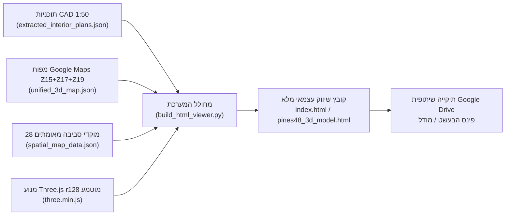

# מסמך אפיון מערכת (PRD & Technical Specification)
## מערכת הדמיה אדריכלית תלת-ממדית וניתוח מרחבי שיווקי — פרויקט פינס 48 פינת הבעל שם טוב, פתח תקווה

> [!IMPORTANT]
> **מטרת העל של המערכת**: מערכת שיווק והצגה אינטראקטיבית (WebGL / Three.js) בקובץ עצמאי (`Standalone HTML`), המשלבת מודל אדריכלי תלת-ממדי מלא בקנה מידה `1:50` (חוץ + פנים מתוך תוכניות הביצוע של **נחומי אדריכלים**) על גבי מפת לוויין ורחובות רב-שכבתית של **Google Maps** עם רדיוסי מרחק ו-28 מוקדי עניין עירוניים מאומתים.

---

## 1. סקירת המוצר וקהל היעד

### 1.1 פרטי הפרויקט האדריכלי
| פרמטר | פירוט מלא במערכת |
| :--- | :--- |
| **שם הפרויקט** | פינס 48 פינת הבעל שם טוב, פתח תקווה |
| **מיקום גיאוגרפי מדויק** | פינה דרום-מערבית של צומת הרחובות יחיאל מיכל פינס והבעל שם טוב (`32.081015°N, 34.893785°E`) |
| **תכנון אדריכלי** | נחומי אדריכלים — תוכניות ביצוע בקנ"מ `1:50` (גיליונות `A-1002`, `A-1003`, `A-1004`, `A-1006`, `A-1007`) |
| **מבנה הפרויקט** | קומת קרקע ולובי (`0.00 = +39.62` אבסולוטי), קומות טיפוסיות `1–5` (דירות A, B, C), קומות פנטהאוז דופלקס `6–7` (דופלקסים PB ו-PC), גג עליון ומגדל מעלית/מדרגות עד `+28.67 מ'` |
| **שימושי המערכת** | פגישות מכירה ושיווק רוכשים, הצגה למשקיעים ושותפים, סיור וירטואלי בדירות יוקרה מרוהטות (A ו-C), ניתוח נגישות עירוני (GIS) ושיתוף קל ללא התקנה דרך Google Drive |

### 1.2 ארכיטקטורת הפצה (Zero-Dependency Standalone Architecture)


- **קובץ יחיד עצמאי (`Single-File Bundle`)**: כל ספריות ה-3D (`Three.js r128`), טקסטורות ה-PBR הפרוצדורליות, תצלומי הלוויין המשולבים (Base64 JPEG) ונתוני ה-CAD וה-GIS מוטמעים ישירות בתוך [index.html](file:///C:/Users/guyku/.gemini/antigravity/scratch/pines-48-3d/index.html) (~6.27 MB).
- **תאימות מלאה לאחסון שיתופי**: פתיחה בלחיצה כפולה מכל מחשב (Windows / Mac) או דרך דפדפן מקומי ללא צורך בשרת חיצוני או בחיבור API פעיל.

---

## 2. אפיון המודל האדריכלי התלת-ממדי (1:50 CAD Geometry)

### 2.1 מערכת הצירים וההתאמה ההנדסית
- **ראשית הצירים של המגרש (CAD Origin)**: המגרש משתרע בטווח `X ∈ [0, 34.10m]`, `Y ∈ [0, 27.80m]`.
- **מרכז המודל התלת-ממדי**: הנקודה `(CX = 17.50m, CY = 13.00m)` ממופה לראשית הצירים של עולם התלת-ממד `(0, 0, 0)` באמצעות הפונקציה:
  $$\text{cadTo3D}(x, y, z) = (x - 17.50,\; z,\; -(y - 13.00))$$
- **אימות גיאוגרפי בצומת**: הפינה הצפון-מזרחית המעוגלת של המגרש יושבת במדויק על שפת המדרכה הדרום-מערבית של צומת הרחובות **פינס** (מצפון) ו**הבעל שם טוב** (ממזרח).

### 2.2 פירוט שכבות הקומות והמפלסים (`layerGroups`)
| מזהה שכבה (`data-layer`) | שם השכבה בממשק | טווח גבהים (מ') | גיליון CAD | תכולה אדריכלית והנדסית |
| :--- | :--- | :--- | :--- | :--- |
| `0_site_and_ground` | **קומת קרקע, לובי ומגרש** | `-2.50` עד `+3.81` | `A-1001 / A-1007` | גבולות מגרש, קו בניין אדום מרוסק, רמפת חניון מזרחית-דרומית, לובי כניסה ראשי מזוגג, חדר עגלות/אופניים, פיר מדרגות ומעלית, גינון ועצים |
| `1_floors_1_to_5` | **קומות 1–5 — דירות A, B, C** | `+3.81` עד `+19.16` | `A-1002` | 5 קומות מגורים טיפוסיות (`+4.25`, `+7.31`, `+10.37`, `+13.43`, `+16.49`), קירות חוץ ופנים אטומים, מרפסות שמש תלויות עם מסגרות טיח אפור B, קורה דקורטיבית מעוגלת בפינה צפון-מזרחית, 3 פירי מסתור כביסה מאלומיניום C, וריהוט יוקרה מלא בקומה 3 |
| `2_floor_6_penthouse` | **קומה 6 — דופלקסים תחתון** | `+19.16` עד `+22.95` | `A-1003` | מפלס תחתון של דופלקס מערבי (`PB`) ודופלקס מזרחי (`PC`), מרפסות גג נרחבות במפלס `+19.72`, מעקות ברזל A ופרגולות בטון מעל מרפסות קומה 5 |
| `3_floor_7_penthouse` | **קומה 7 — דופלקסים עליון** | `+22.95` עד `+25.53` | `A-1004` | מפלס עליון של הדופלקסים (`+22.95`), סוויטות הורים, 2 פרגולות בטון אדריכליות עם רפפות מדויקות ועמודי תמך היורדים לקומה 6 |
| `4_upper_roof_and_tower` | **גג עליון וקולטי שמש** | `+25.53` עד `+28.67` | `A-1006` | מעקות גג עליון, מגדל חדר מדרגות ומעלית עד `+28.67` ומערך של 10 קולטי שמש ודודים |

---

## 3. אפיון הדמיית הפנים היוקרתית — קומה 3 (`+10.37m .. +13.04m`)

בקומה 3 בנויות שתי דירות הדגמה מרוהטות במלואן ברמת גימור שיווקית יוקרתית:

### 3.1 דירה C (4 חדרים — דרום-מזרח, כניסה מול המעלית)
- **חלל מגורים (סלון) ומרפסת שמש מזרחית (`200×500 ס"מ`)**:
  - ספת שזלונג יוקרתית בצורת L עם כריות נוי, שטיח ארוג, שולחן סלון כפול (שיש קלקטה ואלון), קיר כוח מחורץ מעץ אלון (`Fluted Oak`) עם מסך טלוויזיה `75"` ותאורת LED נסתרת.
  - ויטרינת יציאה פתוחה למרפסת המזרחית הפונה לרחוב הבעל שם טוב, כולל פינת ישיבה חיצונית וצמחייה.
- **מטבח ופינת אוכל**:
  - ארונות מטבח בגוון קשמיר ואלון טבעי חם, אי שיש קלקטה (`Calacatta Marble Waterfall Island`) עם כיריים אינדוקציה וכיסאות בר, ופינת אוכל ל-4 סועדים עם גוף תאורה תלוי מוזהב.
- **חדרי שינה ורחצה**:
  - **סוויטת הורים דרום-מערבית (`390×295 ס"מ`)**: רצפת פרקט אלון בהיר, מיטה זוגית מרופדת, שידות צד, ארון קיר בגוון אלון וחדר רחצה צמוד (`En-Suite`) עם מקלחון זכוכית וארון רחצה מרחף.
  - **חדר שינה דרומי (`345×270 ס"מ`)** ו**ממ"ד (`325×300 ס"מ`)**: מרוהטים במיטות, ארונות קיר ושולחנות עבודה/לימוד.
  - **חדר רחצה כללי וחדר שירות**: אמבטיה בנויה, אסלה תלויה, ארון כיור ומכונת כביסה/מייבש.

### 3.2 דירה A (4 חדרים — צפון-מזרח, חזית לרחוב פינס ולהבעש"ט)
- **סלון מרכזי ומרפסת שמש צפונית**: ספת L יוקרתית, קיר טלוויזיה `55"` מעוצב, ויציאה פתוחה למרפסת שמש צפונית הצופה לרחוב פינס.
- **מטבח, אי קלקטה ופינת אוכל**: מטבח פינתי מואר, אי מפל שיש ופינת אוכל ל-4 סועדים.
- **סוויטת הורים צפונית (`385×290 ס"מ`) + מקלחת הורים, ממ"ד מזרחי (`337×280 ס"מ`) וחדר שינה מזרחי (`340×280 ס"מ`)**: מרוהטים במלואם עם פרקט אלון בחדרי השינה וריצוף גרניט פורצלן אפור בהיר (`#b4bac2`) בחללים הציבוריים להדגשת הקונטרסט מול הקירות הלבנים (`#fdfcfb`).

---

## 4. אפיון מנוע הניווט הכפול ומנגנון החתכים

1. **מצב סיור פנים בגוף ראשון (First-Person Walkthrough)**:
   - גובה עיניים אדריכלי קבוע בקומה 3 (`Y = 11.95m`, כלומר `1.58m` מעל מפלס הריצוף `+10.37m`).
   - תנועה רציפה באמצעות מקשי `WASD` / חצים, כפתורי חצים על המסך (`D-Pad`), גלגלת עכבר להליכה קדימה/אחורה, או **לחיצה כפולה (`Double-Click`) על כל נקודה ברצפה** למעבר חלק אליה.
   - הגבלת גבולות חכמה (`clampPositionToAptC`) המונעת יציאה מחוץ לגבולות הקומה.
2. **מצב מבט-על ומודל חתוך (Orbit / Dollhouse Section Mode)**:
   - מישור חיתוך אופקי דינמי (`THREE.Plane(new THREE.Vector3(0, -1, 0), clipHeight)`) החותך בזמן אמת את כל הקירות, העמודים והתקרות בטווח `+0.50m` עד `+29.50m`.
   - כפתור ייעודי **`✨ חתך קומה 3 המרוהטת`** החותך בגובה `+12.68m` (מתחת לתקרת קומה 3) וממקם את המצלמה בזווית איזומטרית אידיאלית מעל דירות A ו-C.

---

## 5. אפיון מערכת ה-GIS התלת-ממדית ומפת הסביבה (Google Maps)

### 5.1 מפת בסיס רב-רזולוציונית (Triple-Resolution Web Mercator Ground Plane)
כדי לשלב חדות מקסימלית בצומת הצמוד לבניין יחד עם כיסוי עירוני מלא עד רדיוס 2 ק"מ, המערכת מרנדרת 3 שכבות קרקע קונצנטריות מיושרות היטב להיטל Web Mercator סביב `(32.081015°N, 34.893785°E)`:

| שכבת מפה | רמת זום (Google Hybrid) | גודל פיזי בעולם התלת-ממדי | רזולוציית קרקע | ייעוד |
| :--- | :--- | :--- | :--- | :--- |
| **שכבה פנימית (Close-Up)** | `Zoom 19` | `259.1m × 259.1m` (`Y = -0.05m`) | **`0.25 מ' לפיקסל`** | חדות מקסימלית של צומת פינס / הבעש"ט, מעברי החצייה והבניינים הצמודים |
| **שכבה שכונתית (Neighborhood)** | `Zoom 17` | `1,619.1m × 1,619.1m` (`Y = -0.08m`) | `1.01 מ' לפיקסל` | כיסוי שכונות מחנה יהודה, עין גנים ומרכז העיר |
| **שכבה עירונית (Regional)** | `Zoom 15` | `7,253.7m × 7,253.7m` (`Y = -0.12m`) | `4.05 מ' לפיקסל` | כיסוי מלא של כל פתח תקווה והצירים הראשיים (40, 471, רכבת קלה ומטרו) |

### 5.2 מעגלי מרחק קונצנטריים (8 טבעות רדיוס תלת-ממדיות)
המערכת מציגה 8 טבעות מרחק סביב הבניין (ניתנות להדלקה/כיבוי בלחיצה אחת):
- **`150 מ'`** (`2 דק' הליכה`) · **`300 מ'`** (`4 דק' הליכה`) · **`500 מ'`** (`6 דק' הליכה`) · **`750 מ'`** (`9 דק' הליכה`) · **`1,000 מ'`** (`12 דק' הליכה`) · **`1,250 מ'`** (`15 דק' הליכה`) · **`1,500 מ'`** (`18 דק' הליכה`) · **`2,000 מ'`** (`24 דק' הליכה`).

### 5.3 מאגר 28 מוקדי הסביבה המאומתים (`SPATIAL_POIS`)
כל מוקד כולל קו רדיאלי תלת-ממדי מהבניין, עמוד תאורה תלת-ממדי, תגית מרחק אינטראקטיבית וכרטיס מידע עם קישור ניווט ישיר ב-Google Maps:

- **🎓 מוסדות חינוך ובתי ספר (9 מוקדים)**:
  1. בי"ס מפתן ברק (`135 מ'`, 2 דק')
  2. מעון מקפ"ת אילה ואשכול גנים (`179 מ'`, 2 דק')
  3. בי"ס לגננות ושתלנות (`292 מ'`, 4 דק')
  4. חטיבת ביניים יצחק בן צבי (`327 מ'`, 4 דק')
  5. בי"ס ממ"ד דרכי נועם (`420 מ'`, 5 דק')
  6. חטיבת ביניים ע"ש י"ח ברנר (`466 מ'`, 6 דק')
  7. בי"ס שובו ובי"ס אמיר בנימיני (`502 מ'`, 6 דק')
  8. תיכון שפרינצק והמכללה למנהל (`604 מ'`, 8 דק')
  9. בי"ס יסודי ברנר ובי"ס מעיינות (`659 מ'`, 8 דק')
- **🚌 תחבורה ציבורית, רכבת קלה, מטרו וצירים ראשיים (7 מוקדים)**:
  10. תחנת מחנה יהודה / קלישר (`42 מ'`, דקה הליכה)
  11. תחנת פינס / צבי הירש קלישר (`134 מ'`, 2 דק')
  12. ציר עין גנים / בי"ס ברנר (`413 מ'`, 5 דק')
  13. כביש 40 – ציר זרובבל / שעריה (`850 מ'`, 2 דק' נסיעה)
  14. **תחנת מטרו עיריית פ"ת — קו M2 העתידי** (`882 מ'`, 11 דק' הליכה / 3 דק' נסיעה, רח' חיים עוזר / העלייה השנייה)
  15. תחנת הרכבת הקלה פינסקר — הקו האדום (`1,490 מ'`, 5 דק' נסיעה)
  16. כביש 471 (מכבית) – מחלף גת רימון (`1,775 מ'`, 4 דק' נסיעה)
- **🛒 קניונים ומרכזי קניות (6 מוקדים)**:
  17. שופרסל אקספרס מחנה יהודה (`377 מ'`) · 18. סיטי מרקט ומרכז מסחרי עין גנים (`460 מ'`) · 19. מרכז מסחרי שעריים ומיני-פארם (`768 מ'`) · 20. קניון עופר סירקין (`965 מ'`) · 21. מרכז רוטשילד (`1,005 מ'`) · 22. קניון גנים והקניון הגדול (`1,935 מ'`).
- **🌳 פארקים, ספורט וקהילה (3 מוקדים)**:
  23. גן זכריה קוהלני (`298 מ'`) · 24. מתנ"ס לזרוס וגינת תשעה (`360 מ'`) · 25. קאנטרי קלאב מינץ וספורטק פ"ת (`908 מ'`).
- **🏥 בריאות ומרפאות (3 מוקדים)**:
  26. מרפאת קופ"ח כללית (`202 מ'`) · 27. קופות חולים לאומית ומאוחדת (`799 מ'`) · 28. מרכז רפואי רבין – קמפוס השרון (`1,210 מ'`).

---

## 6. מבנה תיקיית הפרויקט ותהליך הבנייה

```text
C:\Users\guyku\.gemini\antigravity\scratch\pines-48-3d\
├── index.html                        # מערכת השיווק התלת-ממדית הראשית (Standalone 3D + GIS Viewer)
├── pines48_spatial_map.html          # מפת ה-GIS הדו-ממדית המשלימה
├── pines48_model.glb                 # קובץ מודל תלת-ממדי בינארי לתוכנות חיצוניות (Blender / SketchUp)
├── pines48_model.obj / .mtl          # קובץ מודל Wavefront OBJ + חומרים
├── build_pines48_3d.py               # מחולל גיאומטריית ה-GLB/OBJ מתוך נתוני ה-CAD
├── src/
│   ├── build_html_viewer.py          # סקריפט הבנייה הראשי המייצר את index.html
│   ├── build_seamless_3d_map.py      # סקריפט הורדת וכיול שכבות המפה Z15 + Z17 + Z19 מ-Google Maps
│   └── update_metro_poi.py           # סקריפט ניהול ועדכון מוקדי ה-GIS והמטרו
├── data/
│   ├── extracted_interior_plans.json # פוליגוני הקירות ושרטוטי הפנים שחולצו מתוכניות 1:50
│   ├── unified_3d_map.json           # טקסטורות הלוויין המכוילות (Z15, Z17, Z19)
│   └── spatial_map_data.json         # מאגר 28 מוקדי הסביבה, מרחקים וקואורדינטות
└── docs/
    ├── PRD_SPECIFICATION.md          # מסמך אפיון מערכת מלא (מסמך זה)
    └── DESIGN_SYSTEM.md              # מסמך עיצוב UI/UX וחומרים אדריכליים
```
